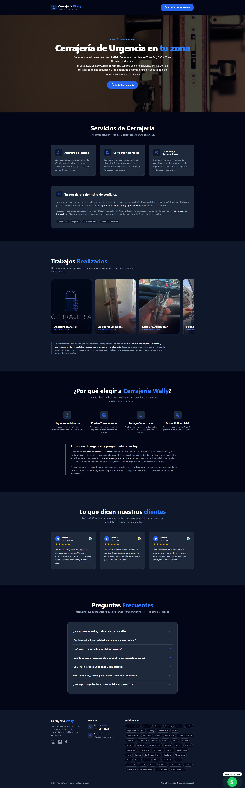
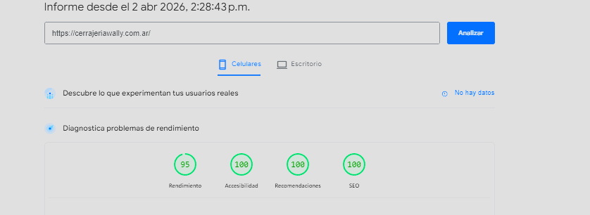
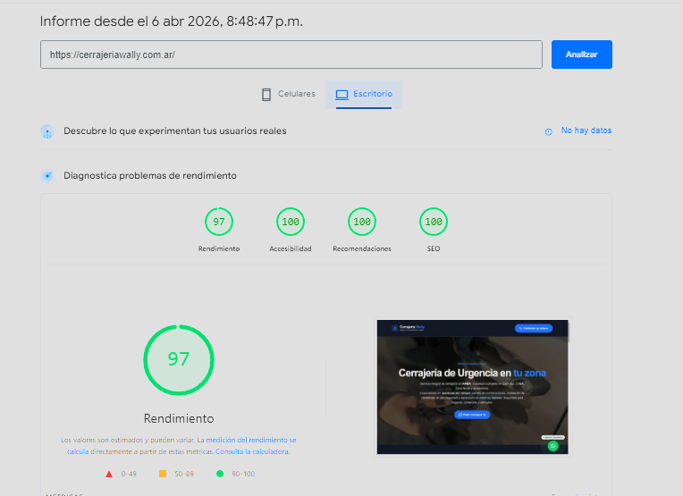

# 🔑 Cerrajería Wally - Landing Page de Alto Rendimiento & Programmatic SEO

Sitio web estático de ultra-alta velocidad desarrollado para un servicio de cerrajería de urgencias 24 horas en Buenos Aires (CABA y GBA). 

El objetivo principal de este proyecto fue maximizar la conversión en dispositivos móviles bajo redes inestables (3G/4G), priorizando el **Performance**, la **experiencia de usuario** y una estrategia avanzada de **SEO Local Programático**.

## 🏆 Resultados de Rendimiento

El proyecto fue auditado con Google PageSpeed Insights, logrando una excelencia técnica en ambas plataformas y un **100/100 en SEO**.

### 📱 Dispositivos Móviles (95/100)

### 💻 Escritorio / Desktop (97/100)

* **LCP (Largest Contentful Paint):** Optimizado para cargar en menos de 1.5s.
* **CLS (Cumulative Layout Shift):** 0.00 (Estructura sólida sin saltos visuales).
* **TBT (Total Blocking Time):** Reducido a cero gracias a la postergación y optimización de scripts.

## 🛠️ Stack Tecnológico

* **Framework:** [Astro.js](https://astro.build/) (Arquitectura de Islas para generar HTML 100% estático sin JavaScript innecesario).
* **Lenguaje:** TypeScript para validación estricta de Props y modelos de datos.
* **Estilos:** [Tailwind CSS](https://tailwindcss.com/) (Sistema de diseño Dark Theme a medida con variables de marca y diseño responsive).
* **SEO Programático:** Integración nativa de `@astrojs/sitemap` con soporte estricto de `trailingSlash: 'always'`.
* **Infraestructura:** Alojamiento con distribución CDN y caché estática en **Cloudflare**.

## 🚀 Optimizaciones Clave Implementadas

### 1. Programmatic SEO (150+ Landing Pages Dinámicas)
Se diseñó un motor de generación de páginas estáticas mediante `getStaticPaths()` en Astro:
* **Cobertura a nivel Municipio y Barrio:** Generación masiva y automática de páginas dedicadas tanto para cabeceras municipales como para barrios específicos (ej. `/cerrajero-zona-lomas-de-zamora/`, `/cerrajero-zona-banfield/`, `/cerrajero-zona-temperley/`).
* **Preservación de Slugs Históricos:** Normalización con `limpiarParaUrl` manteniendo intactas las URLs previamente indexadas bajo el prefijo canónico `cerrajero-zona-[slug]/`.
* **Personalización Dinámica de Contenido (Anti-Duplicación):** Inyección de variables dinámicas (`nombreZona`, `region`, `barrios`) en metadatos (`<title>`, `<meta description>`), encabezados semánticos (`<h1>`, `<h2>`) y llamados a la acción contextuales.

### 2. Arquitectura de Interlinking & Directorio de Cobertura
* **Página de Directorio de Zonas (`/zonas-de-cobertura/`):** Estructura jerárquica con diseño Dark Mode que enlaza cada región, municipio y barrio individualmente para facilitar el rastreo integral por parte de los bots de Google.
* **Footer Inteligente:** Módulo optimizado de zonas de atención con enlaces canónicos y acceso directo al directorio completo.

### 3. Escudo de Interacción GTM (Anti-Bot)
Para evitar que las herramientas de analítica penalicen el rendimiento inicial, se implementó un script que posterga la carga de Google Tag Manager (GTM) y Google Analytics 4 (GA4) hasta que se detecte una interacción humana real (`scroll`, `touchstart`, `click`, `mousemove`), garantizando métricas precisas y excluyendo visitas automatizadas de Lighthouse.

### 4. SEO Semántico y Schema.org
Inyección de JSON-LD estructurado (`@type: "Locksmith"`) detallando rango de precios, área de cobertura geoespacial y horarios de atención (24/7) para potenciar el Local Pack de Google Maps.

### 5. Optimización de Multimedia & Componentes
* **Formato WebP & Responsive Images:** Procesamiento optimizado de imágenes locales con el componente `<Image>` de Astro.
* **Precarga Crítica LCP:** Atributo `fetchpriority="high"` e imágenes marcadas con `loading="eager"` en el primer slide visible del Hero.
* **Carrusel Liviano en Vanilla JS:** Lógica sin dependencias externas para transiciones de fondo e interacción táctil/mouse en la galería de trabajos realizados sin bloquear el hilo principal.